<p align="center">
  
</p>

<p align="center">
  <a href="https://linkedin.com/in/huyhocdata"><b>LinkedIn</b></a> &nbsp;·&nbsp;
  <a href="mailto:hdang1696@gmail.com"><b>hdang1696@gmail.com</b></a> &nbsp;·&nbsp;
  <a href="https://huggingface.co/huyydangg"><b>Hugging Face</b></a> &nbsp;·&nbsp;
  <a href="https://www.tiktok.com/@quanghuyai"><b>TikTok @quanghuyai</b></a>
</p>

## About me

AI Engineer with **2.5+ years** of experience designing, building and optimizing production LLM applications, RAG pipelines and multi-agent systems across **finance, stock market and legal** domains. I work on the whole path from retrieval and agents to LLM serving and the infrastructure that keeps them fast and cheap.

- 💼 AI Engineer at **Mirae Asset Securities Vietnam**
- 🎓 B.Eng. in Data Engineering, **Ho Chi Minh City University of Technology and Engineering**: GPA 3.61/4, 3rd-highest GPA in Data Engineering cohort 21
- 🎯 Working toward **Senior AI Engineer** within the next 3 years
- 🎬 I explain AI topics in Vietnamese on TikTok: [@quanghuyai](https://www.tiktok.com/@quanghuyai)

## Open source

<p align="center">
  <a href="https://huggingface.co/huyydangg/huydang-dek21-embedding">
    
  </a>
</p>

[**huydang-dek21-embedding**](https://huggingface.co/huyydangg/huydang-dek21-embedding) is a Vietnamese sentence-embedding model for semantic search and RAG. It was fine-tuned from `bkai-foundation-models/vietnamese-bi-encoder`, works with `sentence-transformers`, and peaked at **400K downloads per month**.

```python
from sentence_transformers import SentenceTransformer

model = SentenceTransformer("huyydangg/huydang-dek21-embedding")
vectors = model.encode(["Thủ tục mở tài khoản chứng khoán", "Điều kiện ký hợp đồng lao động"])
```

## Tech stack

| Area | Tools |
| --- | --- |
| Languages |   |
| LLM & GenAI |      |
| Models |    |
| Frameworks |    |
| ML / DL |      |
| Data & storage |      |
| Messaging & APIs |      |
| Serving & infra |        |

<p align="center"><sub>Thanks for stopping by. Feel free to reach out about LLM apps, RAG or AI infrastructure.</sub></p>
