<p align="center">
  
</p>

<p align="center">
  <a href="https://linkedin.com/in/huyhocdata"></a>
  <a href="mailto:hdang1696@gmail.com"></a>
  <a href="https://huggingface.co/huyydangg"></a>
  <a href="https://www.tiktok.com/@quanghuyai"></a>
</p>

## About me

AI Engineer with **2.5+ years** of experience designing, developing, and optimizing production-grade **LLM applications, RAG pipelines, and multi-agent systems** across the **finance, stock market, and legal** domains. Experienced in **LLM serving**, **retrieval optimization**, AI infrastructure, and building scalable, cost-efficient AI solutions for enterprise environments.

- 🎓 Bachelor of Engineering in Data Engineering, **Ho Chi Minh City University of Technology and Engineering**
- 🏆 GPA **3.61/4**, **Top 3** in Data Engineering cohort 21
- 🎯 Aiming for **Senior AI Engineer** within 3 years
- 🎬 I share what I learn about AI on TikTok: [@quanghuyai](https://www.tiktok.com/@quanghuyai)

## Open source

<p align="center">
  <a href="https://huggingface.co/huyydangg/huydang-dek21-embedding">
    
  </a>
</p>

[**huydang-dek21-embedding**](https://huggingface.co/huyydangg/huydang-dek21-embedding) is a Vietnamese sentence-embedding model focused on legal documents, built for legal search and RAG. It was fine-tuned from `bkai-foundation-models/vietnamese-bi-encoder`, works with `sentence-transformers`, and peaked at **400K downloads per month**.

```python
from sentence_transformers import SentenceTransformer

model = SentenceTransformer("huyydangg/huydang-dek21-embedding")
vectors = model.encode(["Điều kiện ký hợp đồng lao động", "Thủ tục cấp giấy chứng nhận quyền sử dụng đất"])
```

## Tech stack

| Area | Tools |
| --- | --- |
| Languages |   |
| LLM & GenAI |      |
| Models | ![OpenAI GPT](https://img.shields.io/badge/OpenAI_GPT-F1F5F9?style=flat-square&logo=data%3Aimage%2Fsvg%2Bxml%3Bbase64%2CPHN2ZyB3aWR0aD0iMjQiIGhlaWdodD0iMjQiIGZpbGw9IiMwMDAwMDAiIGZpbGwtcnVsZT0iZXZlbm9kZCIgdmlld0JveD0iMCAwIDI0IDI0IiB4bWxucz0iaHR0cDovL3d3dy53My5vcmcvMjAwMC9zdmciPjxwYXRoIGQ9Ik0yMS42IDEwYTUuNCA1LjQgMCAwIDAtLjUtNC41Yy0xLjItMi4xLTMuNy0zLjItNi0yLjdBNS42IDUuNiAwIDAgMCAxMC44IDFDOC40IDEgNi4yIDIuNSA1LjUgNC44QTUuNiA1LjYgMCAwIDAgMS44IDcuNWE1LjUgNS41IDAgMCAwIC43IDYuNSA1LjQgNS40IDAgMCAwIC41IDQuNWMxLjIgMi4xIDMuNyAzLjIgNiAyLjdBNS42IDUuNiAwIDAgMCAxMy4yIDIzYzIuNCAwIDQuNi0xLjUgNS40LTMuOGE1LjYgNS42IDAgMCAwIDMuNy0yLjcgNS41IDUuNSAwIDAgMC0uNy02LjV2MHptLTguNCAxMS42YTQuMiA0LjIgMCAwIDEtMi43LTFjMCAwIC4xLS4xIC4xLS4xbDQuNC0yLjVhLjcgLjcgMCAwIDAgLjQtLjZ2LTYuMmwxLjkgMS4xYzAgMCAwIDAgMCAuMXY1LjFjMCAyLjMtMS45IDQuMS00LjIgNC4xek00LjIgMTcuOGE0LjEgNC4xIDAgMCAxLS41LTIuOGMwIDAgLjEgLjEgLjEgLjFsNC40IDIuNWMuMiAuMSAuNSAuMSAuNyAwbDUuNC0zLjF2Mi4xYS4xIC4xIDAgMCAxIDAgLjFMOS45IDE5LjNjLTIgMS4xLTQuNiAuNS01LjctMS41aDB6TTMgOC4yQTQuMiA0LjIgMCAwIDEgNS4yIDYuNGwwIC4ydjUuMWEuNyAuNyAwIDAgMCAuNCAuNmw1LjQgMy4xLTEuOSAxLjFhLjEgLjEgMCAwIDEtLjEgMGwtNC41LTIuNmMtMi0xLjEtMi43LTMuNy0xLjUtNS42aDB6bTE1LjQgMy41bC01LjQtMy4xTDE0LjkgNy42YS4xIC4xIDAgMCAxIC4xIDBsNC41IDIuNmMyIDEuMSAyLjcgMy43IDEuNSA1LjZhNC4yIDQuMiAwIDAgMS0yLjIgMS44VjEyLjRhLjcgLjcgMCAwIDAtLjQtLjZ6bTEuOS0yLjhhNiA2IDAgMCAwLS4xLS4xbC00LjQtMi41YS43IC43IDAgMCAwLS43IDBsLTUuNCAzLjFWNy4zYS4xIC4xIDAgMCAxIDAtLjFMMTQuMSA0LjdjMi0xLjEgNC42LS41IDUuNyAxLjUgLjUgLjggLjcgMS44IC41IDIuOGgwem0tMTEuNyAzLjhsLTEuOS0xLjFhLjEgLjEgMCAwIDEgMC0uMVY2LjZjMC0yLjMgMS45LTQuMSA0LjItNC4xIDEgMCAxLjkgLjMgMi43IDEgMCAwLS4xIC4xLS4xIC4xbC00LjQgMi41YS43IC43IDAgMCAwLS40IC42bDAgNi4ydjB6bTEtMi4yTDEyIDkuMmwyLjQgMS40djIuOEwxMiAxNC44bC0yLjQtMS40di0yLjh6Ij48L3BhdGg%2BPC9zdmc%2B)  ![Qwen](https://img.shields.io/badge/Qwen-F1F5F9?style=flat-square&logo=data%3Aimage%2Fsvg%2Bxml%3Bbase64%2CPHN2ZyB3aWR0aD0iMjQiIGhlaWdodD0iMjQiIHZpZXdCb3g9IjAgMCAyNCAyNCIgeG1sbnM9Imh0dHA6Ly93d3cudzMub3JnLzIwMDAvc3ZnIj48ZGVmcz48bGluZWFyR3JhZGllbnQgaWQ9ImxvYmUtaWNvbnMtcXdlbi1maWxsIiB4MT0iMCUiIHgyPSIxMDAlIiB5MT0iMCUiIHkyPSIwJSI%2BPHN0b3Agb2Zmc2V0PSIwJSIgc3RvcC1jb2xvcj0iIzAwMDU1RiIgc3RvcC1vcGFjaXR5PSIuODQiPjwvc3RvcD48c3RvcCBvZmZzZXQ9IjEwMCUiIHN0b3AtY29sb3I9IiM2RjY5RjciIHN0b3Atb3BhY2l0eT0iLjg0Ij48L3N0b3A%2BPC9saW5lYXJHcmFkaWVudD48L2RlZnM%2BPHBhdGggZD0iTTEyLjYgMS4zYy40IC43IC44IDEuNCAxLjIgMi4xYS4yIC4yIDAgMCAwIC4yIC4xaDUuNmMuMiAwIC4zIC4xIC40IC4zbDEuNSAyLjZjLjIgLjMgLjIgLjUgMCAuOC0uMyAuNC0uNSAuOS0uOCAxLjNsLS40IC43Yy0uMSAuMi0uMiAuMyAwIC41bDIuNyA0LjZjLjIgLjMgLjEgLjUgMCAuOC0uNCAuOC0uOSAxLjYtMS4zIDIuMy0uMiAuMy0uNCAuNC0uNyAuNC0uOCAwLTEuNiAwLTIuMyAwYS4xIC4xIDAgMCAwLS4xIC4xIDU3NS4xIDU3NS4xIDAgMCAxLTIuNyA0LjdjLS4yIC4zLS40IC40LS43IC40LTEgMC0yIDAtMyAwYS41IC41IDAgMCAxLS41LS4zbC0xLjMtMi4zYS4xIC4xIDAgMCAwLS4xIDBINWMtLjMgMC0uNiAwLS44LS4xbC0xLjYtMi44YS41IC41IDAgMCAxIDAtLjVsMS4yLTIuMWEuMiAuMiAwIDAgMCAwLS4yIDU1MSA1NTEgMCAwIDEtMS45LTMuM2wtLjgtMS40Yy0uMi0uMy0uMi0uNSAuMS0xIC41LS44IC45LTEuNiAxLjQtMi40IC4xLS4yIC4zLS4zIC42LS4zYTMzOC4zIDMzOC4zIDAgMCAxIDIuNiAwIC4xIC4xIDAgMCAwIC4xLS4xbDIuOC00LjlhLjUgLjUgMCAwIDEgLjQtLjJjLjUgMCAxLjEgMCAxLjYgMEwxMS43IDFjLjMgMCAuNyAwIC45IC4zem0tMy40IC40YS4xIC4xIDAgMCAwLS4xIDBMNi4zIDYuOGEuMiAuMiAwIDAgMS0uMSAuMUgzLjNjLS4xIDAtLjEgMCAwIC4xbDUuOCAxMC4yYzAgMCAwIC4xIDAgLjFsLTIuOCAwYS4yIC4yIDAgMCAwLS4yIC4xbC0xLjMgMi4zYzAgLjEgMCAuMSAuMSAuMWw1LjcgMGMwIDAgLjEgMCAuMSAuMWwxLjQgMi41YzAgLjEgLjEgLjEgLjEgMGw1LTguOCAuOC0xLjRhLjEgLjEgMCAwIDEgLjEgMGwxLjQgMi41YS4xIC4xIDAgMCAwIC4xIC4xbDIuOCAwYTAgMCAwIDAgMCAwIDAgMCAwIDAgMCAwIDAgMGwtMi45LTUuMWEuMSAuMSAwIDAgMSAwLS4xbC4zLS41IDEuMS0yYzAgMCAwLS4xIDAtLjFIOS4yYy0uMSAwLS4xIDAgMC0uMWwxLjQtMi41YS4xIC4xIDAgMCAwIDAtLjFMOS4yIDEuOGEuMSAuMSAwIDAgMC0uMSAwem02LjMgOGMwIDAgLjEgMCAwIC4xbC0uOCAxLjUtMi42IDQuNmEuMSAuMSAwIDAgMS0uMSAwIC4xIC4xIDAgMCAxLS4xIDBMOC41IDkuOGMwIDAgMC0uMSAwLS4xbC4yIDAgNi43IDB6IiBmaWxsPSJ1cmwoI2xvYmUtaWNvbnMtcXdlbi1maWxsKSIgZmlsbC1ydWxlPSJub256ZXJvIj48L3BhdGg%2BPC9zdmc%2B) |
| Frameworks |   ![Langfuse](https://img.shields.io/badge/Langfuse-F1F5F9?style=flat-square&logo=data%3Aimage%2Fsvg%2Bxml%3Bbase64%2CPHN2ZyB3aWR0aD0iMjQiIGhlaWdodD0iMjQiIGZpbGw9IiMwRjE3MkEiIGZpbGwtcnVsZT0iZXZlbm9kZCIgdmlld0JveD0iMCAwIDI0IDI0IiB4bWxucz0iaHR0cDovL3d3dy53My5vcmcvMjAwMC9zdmciPjxnPjxwYXRoIGQ9Ik02LjcgMTMuMmMyIDAgMy4xIC4yIDQgLjZhNi4xIDYuMSAwIDAgMSAxLjMgLjhsLjQgLjRjMSAuOCAyLjIgMS4zIDMuNSAxIC4yIDAgLjQtLjEgLjYtLjJhNi4yIDYuMiAwIDAgMSAyLjUgLjJsLjMgLjFjLjUgLjIgMSAuNCAxLjQgLjdsLjIgLjItLjIgLjJjLTEgMS4yLTIuNCAxLjktMy45IDJsLS4yIDBjLTEuNCAuMS0yLjctLjMtMy44LTEuMWwwIDAtLjMtLjJhOC40IDguNCAwIDAgMS0uNC0uM2wtLjItLjItLjMtLjJjLTEuMi0uNi0yLjMtLjktMy4xLTEuMWwtLjgtLjItLjItLjEgMCAwIDAgMCAwIDAgMCAuMSAwLS4xYTMuNyAzLjcgMCAwIDEtLjctLjNsLS4zLS4xLS4zLS4yYTIuNCAyLjQgMCAwIDEtLjYtLjZsLS4xLS4yLS4xLS4yYTIuNCAyLjQgMCAwIDEtLjItLjdsMC0uMSAuMiAwIC4yIDBjLjIgMCAuMyAwIC41IDBoLjV6bS01LjQgMS4zYy4xIC4zIC4yIC42IC4zIC45bC4xIC4yYy4yIC40IC40IC45IC42IDEuMmwtMS41IDFjMCAwLS4xIDAtLjEgMFYxNC44bDAgMCAwIDAgLjYtLjN6bTIxLjEtNGwuMSAuMiAwIC4yIDAgLjFjMCAuMyAwIC41IDAgLjhsMCAuNGMwIC40IDAgLjgtLjEgMS4ybC0uMSAuM2E5LjggOS44IDAgMCAwLTMtMWwwLS4xYzAtLjIgLjEtLjUgLjEtLjdhMi40IDIuNCAwIDAgMCAwLS40bDAgMGExMS40IDExLjQgMCAwIDAgMi42LS43bC4zLS4xek0xMi4xIDZjMS4yLS45IDIuNy0xLjYgNC42LTEuNGE2LjMgNi4zIDAgMCAxIDIuNiAuOWwuMiAuMWMuNCAuMiAuNyAuNiAxIC45bC4yIC4yLS4yIC4xLS4yIC4xYTYuNSA2LjUgMCAwIDEtLjcgLjNjLS4xIC4xLS4zIC4xLS41IC4yYTYuMyA2LjMgMCAwIDEtMi44IC4yYy0uOS0uMi0yLS4xLTIuOSAuNC0uNCAuMi0uOCAuNS0xLjEgLjhsLS4zIC4zLS4yIC4yLS40IC40YTUuOCA1LjggMCAwIDEtMS4xIC43Yy0uOCAuNC0yIC41LTQgLjRsLS42IDAtLjIgMC0uMSAwIC4xLS4yYy4xLS4zIC4zLS41IC41LS43IC4zLS4zIC41LS41IC44LS43bC4yLS4xIC4xLS4xIC4xLS4xIC4yLS4xYTEyLjMgMTIuMyAwIDAgMCAxLjYtLjhjMS4xLS42IDIuMS0xLjQgMi44LTJsLjEtLjF6bS0xMS41IC4zbDAgMCAuMyAuMmMuMyAuMiAuNiAuNCAuOSAuNmwuNCAuMi0uMSAuMmMtLjIgLjMtLjMgLjUtLjUgLjlsLS4xIC4zYTYuMSA2LjEgMCAwIDAtLjIgLjVsLS4xIC4yLS42LS42YS4xIC4xIDAgMCAxIDAgMFY2LjRjMCAwIDAtLjEgLjEtLjF6Ij48L3BhdGg%2BPHBhdGggZD0iTTcuNiA1YTYuMyA2LjMgMCAwIDEgMy4yIC45bC4yIC4xLS4yIC4yYTE0LjcgMTQuNyAwIDAgMS0yLjYgMS43bC0uMSAuMS0uMyAuMS0uMyAuMWE0LjQgNC40IDAgMCAwLS43IC4zbC0uMSAuMWE0LjMgNC4zIDAgMCAwLTIuMSAzLjRsMCAuMnYuM2wwIC41YzAgLjMgMCAuOCAuMyAxLjRsLjEgLjJjLjEgLjEgLjIgLjMgLjMgLjQgLjIgLjMgLjQgLjUgLjcgLjZsLjIgLjJjLjQgLjMgLjkgLjUgMS40IC42bC44IC4yYy4zIC4xIC42IC4yIDEgLjMgLjggLjMgMS42IC42IDIuNSAxbC4yIC4xLS4yIC4xYy0uNyAuNS0yLjMgMS41LTQuNCAxLjNhNi4zIDYuMyAwIDAgMS0yLjctLjkgNS44IDUuOCAwIDAgMS0xLjctMS41bC0uMS0uMmE3LjYgNy42IDAgMCAxLTEuMS0yLjhsLS4xLS40IDAgMGE5LjQgOS40IDAgMCAxIDAtMi45bDAgMCAuMS0uN2MwLS4xIC4xLS4zIC4xLS40bC4xLS4zYTYuMiA2LjIgMCAwIDEgLjktMS44bC4zLS40QzQuMSA2IDUuNSA1LjIgNy4yIDUuMWwuMiAwIC4zIDB6bTcuOCA4Yy43IDAgMS40IDAgMi4zIDBsLjQgMGE4LjkgOC45IDAgMCAxIC43IC4xIDEzIDEzIDAgMCAxIDMgMWwuNCAuMmMuMyAuMiAuNiAuNCAuOCAuNWwuMiAuMiAwIDAgMCAwdjIuNWwwIDAgMCAwYS4xIC4xIDAgMCAxIDAgMGwwIDAgMCAwIDAgMC0uMS0uMWE5LjIgOS4yIDAgMCAwLTEuNC0xbC0uMi0uMS0uMS0uMWE3IDcgMCAwIDAtMi4zLTEuMWwtLjItLjFhNi45IDYuOSAwIDAgMC0yLjQtLjFsLS4yIDAtLjIgLjEtLjIgMC0uMiAwYy0xLjMgLjItMi4zLS40LTMtLjlsLS4zLS4yIC4yLS4yYy4zLS4yIC41LS40IC44LS41IC41LS4zIDEuMi0uNCAyLS40em03LjgtN2EwIDAgMCAwIDEgLjEgMGwwIDB2My4xbDAgMCAwIDBhMTEgMTEgMCAwIDEtMS45IC45Yy0uMyAuMS0uNSAuMi0uNyAuMi0uNSAuMS0xLjEgLjMtMS41IC4zbC0uMyAuMWMtLjMgMC0uNiAuMS0uOSAuMWwtLjMgMGMtMS44IDAtMy4xLS4xLTQuMS0uNWwtLjItLjFhNi4xIDYuMSAwIDAgMS0uNy0uNGwtLjEtLjFjLjEtLjEgLjItLjIgLjQtLjRsLjItLjJjLjItLjIgLjMtLjMgLjUtLjQgLjgtLjYgMS45LS44IDIuOC0uNWwuMyAwYTcgNyAwIDAgMCAyLjUtLjJsLjMtLjFjLjItLjEgLjQtLjEgLjYtLjJsLjUtLjJjLjItLjEgLjQtLjIgLjYtLjNsLjEgMGExMC44IDEwLjggMCAwIDAgMi4yLTEuMnoiPjwvcGF0aD48L2c%2BPC9zdmc%2B) |
| ML / DL |    |
| Data & storage |     |
| Messaging & APIs |     |
| Serving & infra |      |

<p align="center"><sub>Thanks for stopping by. Feel free to reach out about LLM apps, RAG or AI infrastructure.</sub></p>
